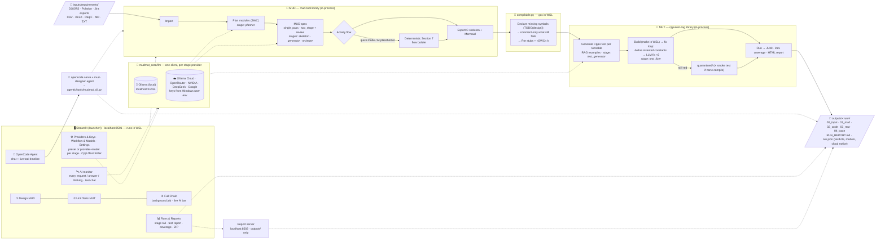

# MUD_MUT — Local-AI AUTOSAR Module Unit Design → Unit Tests

> **From architectural requirements → validated MUD flow charts → AUTOSAR CppUTest unit tests.**
> One ASPICE-aligned pipeline. Runs on **local models by default** — your requirements, designs, and code
> stay on your machine. Cloud models (Ollama Cloud, OpenRouter, NVIDIA, DeepSeek, Google) are optional, switched
> on per stage, and every run report says whether any data left the machine. One Streamlit platform, **no Docker**.
>
> **New here? Read the step-by-step guide: [docs/HOW_TO_USE.md](docs/HOW_TO_USE.md).**


---

## Why this exists

ASPICE (and every serious functional-safety process) expects unit tests to be **traceable to the module/unit
design** — not written from a developer's memory of the code. In practice most teams treat that link as
paperwork and skip the design-driven step. **MUD_MUT closes that gap with local AI:** it generates the
**Module Unit Design flow charts** from requirements *and* the **unit tests** from those same designs, keeping a
requirement → design → test trace throughout.

It is built **local-first** for two reasons that are also its selling points:

- **Performance & cost** — runs offline on a single workstation/GPU; no per-token API bill.
- **Privacy** — proprietary automotive requirements and code stay on-prem, which matters under NDA/ASPICE.

A small local model on its own is not trustworthy enough for safety work — so MUD_MUT never trusts it blindly.
Every AI step is wrapped in **deterministic guardrail layers** (see [Reliability](#how-we-make-local-models-reliable)).

---

## Pipeline at a glance

> Keep this diagram current — update it in the same change whenever a stage, fallback or default model changes.



Every run is saved in `outputs/<YYYYMMDD_HHMMSS>_<SWC>_<preset>/` with one folder per stage and a
`RUN_REPORT.md` (✅/⚠️/❌ per stage, the provider + model used for every stage, and whether any data
was sent to a cloud provider). `outputs/LATEST` names the most recent run.

## One platform, two halves

```
requirements.csv
      │
      ▼
┌──────────────────────────────────────────────────────────────────────────────┐
│                         Streamlit platform  (launcher/)                       │
│                                                                               │
│  ① Design (MUD)                     ② Unit Tests (MUT)        ③ Full Chain   │
│  import → plan → MUD spec            C → RAG → CppUTest tests   one-click     │
│  → activity flow → C skeleton        → build/run → coverage     end-to-end    │
│  → compilability report              → requirement↔test trace                 │
│                                                                               │
│        └──────── mudmut_core/  (shared in-process engine) ────────┘           │
└──────────────────────────────────────────────────────────────────────────────┘
        │                                       │
        ▼                                       ▼
  mud-tool/  (design lib)              cpputest-rag/  (verify lib)
  Ollama on localhost:11434            C/C++ build via WSL (make/gcc/lcov)
```

| Folder | What it is | Notes |
|---|---|---|
| [`launcher/`](launcher/) | The Streamlit platform (router + `views/`: Overview · Requirements & design · Unit tests · Full chain · Runs & reports · AI monitor · Models · Keys · Settings · OpenCode agent) | `./launch.sh` / `launch.bat` |
| [`mudmut_core/`](mudmut_core/) | The shared in-process engine (design, compilable, verify, trace, report, chain, LLM providers, stage registry) | used by the UI, the CLI, the agent and the tests |
| [`mud-tool/`](mud-tool/) | Requirements → MUD spec → validated AUTOSAR flow charts → C-skeleton export | in-process library |
| [`cpputest-rag/`](cpputest-rag/) | C code → FAISS RAG → CppUTest unit tests → build & coverage | in-process library |
| [`agentic/`](agentic/) | OpenCode agent layer (`mudmut_cli.py` tools on `mudmut_core`) | [agentic/README.md](agentic/README.md) |
| `inputs/` · `outputs/` | Requirements, guidelines, skills, test examples · one folder per run | `config/` holds presets + your stage selection |

---

## Documentation

| Document | What it covers |
|---|---|
| [docs/HOW_TO_USE.md](docs/HOW_TO_USE.md) | **Step-by-step guide to every stage and page**, reading results, troubleshooting |
| [docs/pipeline.md](docs/pipeline.md) | The stages, their outputs, re-running tests by hand, the traceability rule |
| [docs/providers.md](docs/providers.md) | Providers, free models, the probe, capping the local context window |
| [agentic/README.md](agentic/README.md) | The OpenCode agent layer |
| [docs/PROJECT_OVERVIEW.md](docs/PROJECT_OVERVIEW.md) | Project background, learnings and honest limits |

## Quick start (local, no Docker)

**Prerequisites:** [Ollama](https://ollama.com) and Linux, or **WSL (Ubuntu) on Windows**. The platform
(Python venv, Streamlit, gcc/make/CppUTest/lcov) runs inside Linux/WSL; on Windows, `setup.bat` and
`launch.bat` just start `setup.sh` / `launch.sh` in WSL, and you open http://localhost:8501 in your
Windows browser. Ollama can run natively on Windows (WSL reaches it at `localhost:11434`).

```bash
# 1. Pull the local model set (one time)
ollama pull qwen3:8b             # design / MUD generation
ollama pull qwen2.5:7b           # test generation (cpputest-rag)
ollama pull all-minilm           # test-example RAG embeddings
ollama pull nomic-embed-text     # guidelines RAG embeddings (MUD_GUIDELINES_EMBED_MODEL)

# Capped 16k-context copy used by the presets (fits an 8 GB GPU; shares the weights, no extra download)
printf 'FROM qwen3:8b\nPARAMETER num_ctx 16384\n' > /tmp/Modelfile
ollama create qwen3:8b-ctx16384 -f /tmp/Modelfile

# 2. Copy the env preset (native, localhost Ollama)
cp .env.local.example .env

# 3. One-time setup: creates .venv + installs the engine + Streamlit
./setup.sh                       # Windows: setup.bat

# 4. Install the C/C++ toolchain inside WSL (once, as root)
wsl -u root -e apt-get install -y build-essential cpputest lcov
#    (or build CppUTest yourself into Tools/cpputest-install, or set its folder on the Settings page)

# 5. Launch the platform
./launch.sh                      # Windows: launch.bat
# → opens http://localhost:8501
```

Then use the pages (details for each in [docs/HOW_TO_USE.md](docs/HOW_TO_USE.md)):

1. **Start ▸ Overview** — Ollama, the WSL build tools (incl. CppUTest) and cloud keys should be green.
2. **Setup ▸ Settings** — CppUTest folder (empty = auto-detect), optional compiler flags; **Check** shows what was found.
3. **Setup ▸ Keys & providers** — test each provider; **Probe free models** marks which free cloud models really answer.
4. **Setup ▸ Models** — flow charts of every workflow, and a **provider + model per stage** (presets: *Local - recommended*,
   *Local - fast*, *OpenRouter - free*, *NVIDIA NIM*, *DeepSeek*, *Ollama Cloud*).
5. **Review ▸ AI monitor** — press **Quick test** in the test chat to confirm a model answers before a long run.
6. **Verify ▸ Full chain** — one click end-to-end with a live progress bar, writing `outputs/<run>/RUN_REPORT.md`.
   Or go step by step: **Design ▸ Requirements & design**, then **Verify ▸ Unit tests**.
7. **Review ▸ Runs & reports** — test report, coverage, run report, per-test results, ZIP download, compare runs.

The **current run** and a nine-box **stage rail** (green/amber/red/grey per stage) are shown at the top of every page.

Each run writes to `outputs/<run>/` (see below).

Prefer the CLI?

```bash
python -m mudmut_core.chain --requirements inputs/requirements/samples/bms_requirements.csv \
    --swc SWC_BatteryManagement --quick --preset local-fast
```

## Models & providers

Every pipeline stage has a **provider** (Ollama · Ollama Cloud · OpenRouter · NVIDIA NIM · DeepSeek · Google) and a
**model**. Change them on the *Models* page or apply a preset (`config/presets.json`); the current selection
persists in `config/stages.json` (gitignored). Cloud providers send your data off-machine and are recorded in every
`RUN_REPORT.md`. Free models are tagged 🆓 and can be probed (✅ answers · ⚠️ rate-limited · ❌ retired · 💲 needs
credits) — see [docs/providers.md](docs/providers.md).

API keys are read from your environment (Windows user variables such as `OPENROUTER_API_KEY`, `NVIDIA_API_KEY`,
`DEEPSEEK_API_KEY`, `GOOGLE_GENERATIVE_AI_API_KEY`, `OLLAMA_API_KEY` / repo `.env` / process) — never written to
disk; the Keys page only ever shows "key found" / "no key".

### Outputs

```
outputs/
  LATEST                         ← name of the most recent run
  <YYYYMMDD_HHMMSS>_<SWC>_<preset>/
    RUN_REPORT.md                ← per-stage verdict ✅/⚠️/❌, models, cloud notice, timings
    run.json                     ← same, machine-readable
    llm_log.jsonl                ← every request/answer between the app and the models
    00_input/  01_mud/  02_code/  03_mut/  04_trace/
```

`03_mut/` also holds a generated `Makefile` and `build_and_run.bat` / `build_and_run.sh`: run them to recompile and
re-run the tests by hand (they use the CppUTest folder from Settings).

### What to expect from local 7B models

On an RTX 4060 (8 GB) with `qwen3:8b-ctx16384`, a quick run of the BMS sample takes about 13 minutes (the
spec stage is roughly 60 % of it); a full run with review and AI activity takes longer. Use the `-ctx16384` model variants: the plain
`qwen3:8b` loads with a 40k context, spills half onto the CPU, and is about 2× slower. Set both
`MUD_OPENAI_MODEL` and `MUD_PIPELINE_GENERATOR_MODEL` in `mud-tool/python-sidecar/.env`.

Every stage is guarded, so the chain always finishes with a truthful report rather than a fake pass:

- **Activity diagrams:** if the model's diagram is a placeholder, the deterministic Section 7 builder
  takes over and the log says so.
- **C skeleton:** symbols the MUD never defines are declared as `TODO(design)` placeholders. Only
  statements that still can't compile are commented out, as `/* TODO(design): … */`. The report states
  how many statements were kept as C.
- **Unit tests:** a fix loop first defines constants the model invented (`TODO(test)`), then asks the
  model to fix the remaining errors.
  - Test files that still don't compile are moved to `quarantined/` and listed.
  - If none compile, a deterministic smoke test runs every runnable once (clearly labelled).
  - Test failures are real results: compare them with the design before trusting either side.
- **Traceability:** a requirement is marked `verified_by_test` only when a test exercises a function
  whose design carries its ID. Everything else is reported as `not_verified`.

All output is an AI-assisted draft, not certified tooling (see `AGENTS.md`).

---

## How we make local models reliable

The moat isn't the model — it's the **guardrail layers** wrapped around it. These make a small local model's
output trustworthy enough to work with:

- **Generator ↔ Reviewer pipeline** — one local model generates, a second reviews & corrects.
- **AI reviewer pass** — coverage %, issues by section, ASIL-C/D safety & naming-convention checks.
- **Grounding** — AUTOSAR vocabulary catalog + design "skills" + RAG over your design guidelines.
- **Deterministic validators** — structural + AUTOSAR + consistency checks, Mermaid linting, JSON-schema
  validation with automatic repair/retry on low confidence.
- **Compilability guardrail** — the C skeleton is compiled with `gcc -std=c99 -fsyntax-only` in a loop; each
  statement the compiler rejects is turned into `/* TODO(design): … */`, and the kept/stubbed count is reported.
- **Test-side guardrails** — generate → compile/run → feed failures back to a model → regenerate (fix loop).
- **Provenance** — every AI output carries model id, prompt version, and a confidence score.

---

## Repository layout

```
MUD_MUT/
├── README.md                 ← you are here
├── LICENSE                   ← Apache-2.0
├── CONTRIBUTING.md
├── CODE_OF_CONDUCT.md
├── setup.sh / setup.bat      ← one-time setup (venv + deps)
├── launch.sh / launch.bat    ← launch the Streamlit platform
├── .env.example / .env.local.example / .env.auto.example
├── docs/                     ← HOW_TO_USE.md · pipeline.md · providers.md · PROJECT_OVERVIEW.md
├── Tools/                    ← optional local checkouts, e.g. a CppUTest build (git-ignored)
├── config/                   ← presets.json (tracked) · stages.json (your selection, git-ignored)
├── inputs/                   ← requirements/ (samples/) · guidelines/ · skills/ · test_examples/
├── outputs/                  ← <run>/ 00_input · 01_mud · 02_code · 03_mut · 04_trace · RUN_REPORT.md
├── launcher/
│   ├── streamlit_app.py      ← router: theme, run bar + stage rail, grouped menu
│   └── views/                ← Overview · Design · Unit tests · Full chain · Runs & reports · AI monitor · Models · Keys · Settings · OpenCode agent
├── mudmut_core/              ← the shared in-process engine (UI + CLI + agent + tests)
├── agentic/                  ← OpenCode agent layer (CLI tools, client, eval)
├── mud-tool/                 ← DESIGN half (history-preserved subtree)
└── cpputest-rag/             ← VERIFICATION half (history-preserved subtree)
```

---

## Security notes (read before exposing anything)

- **Localhost only.** Everything runs locally; the C/C++ build runs inside WSL. This is fine on a local dev
  machine but **must not be exposed to a network**.
- **Secrets never in git.** `.env` is ignored; ship only `*.example` files with placeholders. If you previously
  used a cloud API key locally, rotate it if there's any chance it was shared.

---

## Publishing to GitHub

```bash
gh repo create MUD_MUT --public --source=. --remote=origin --push
```

CI runs automatically on push/PR via [.github/workflows/ci.yml](.github/workflows/ci.yml).

## Agentic mode (OpenCode layer)

An optional extra layer: the **OpenCode Agent** page starts `opencode serve` inside WSL and lets the
`mud-designer` agent drive the same engine through `agentic/tools/mudmut_cli.py`. Every tool call is shown
live in a timeline, permission requests can be approved inline, and the agent's run lands in
`outputs/<run>/` like any other run (visible in Runs & Reports). Needs a native OpenCode in WSL:

```bash
curl -fsSL https://opencode.ai/install | bash      # inside WSL; installs ~/.opencode/bin/opencode
```

See [agentic/README.md](agentic/README.md).

---

## License

[Apache License 2.0](LICENSE). Contributions welcome — see [CONTRIBUTING.md](CONTRIBUTING.md).
