# MUD_MUT — Local-AI AUTOSAR Module Unit Design → Unit Tests

> **From architectural requirements → validated MUD flow charts → AUTOSAR CppUTest unit tests.**
> One ASPICE-aligned pipeline. Runs entirely on **local 7B models** — your requirements, designs, and code
> never leave your machine. An optional cloud/API backend is available when you want it.


---

## Why this exists

ASPICE (and every serious functional-safety process) expects unit tests to be **traceable to the module/unit
design** — not written from a developer's memory of the code. In practice most teams treat that link as
paperwork and skip the design-driven step. **MUD_MUT closes that gap with local AI:** it generates the
**Module Unit Design flow charts** from requirements *and* the **unit tests** from those same designs, keeping a
requirement → design → test trace throughout.

It is built **local-first on 7B models** for two reasons that are also its selling points:

- **Performance & cost** — runs offline on a single workstation/GPU; no per-token API bill.
- **Privacy** — proprietary automotive requirements and code stay on-prem, which matters under NDA/ASPICE.

A small 7B model on its own is not trustworthy enough for safety work — so MUD_MUT never trusts it blindly.
Every AI step is wrapped in **deterministic guardrail layers** (see [Reliability](#how-we-make-7b-models-reliable)).

---

## Pipeline at a glance

> Keep this diagram current — update it in the same commit whenever a stage, endpoint, port or model changes.

```mermaid
flowchart LR
    REQ[/"📄 Requirements<br/>CSV · XLSX · MD · TXT"/]

    subgraph DESIGN["🧩 mud-tool — DESIGN half (MUD) · :8042"]
        direction TB
        IMP["1 · Import<br/>POST /requirements/import"]
        PLAN["2 · Module plan (SWC split)<br/>POST /modules/plan"]
        SPEC["3 · MUD spec — 2-stage<br/>POST /modules/mud-spec (SSE)<br/><i>deepseek-r1:7b → qwen3:8b</i>"]
        REV{"4 · AI review<br/>POST /modules/review<br/><i>deepseek-r1:7b</i>"}
        REGEN["Regenerate<br/>POST /modules/mud-spec/regenerate"]
        GEN["5 · Flow charts + UML<br/>POST /generate (activity, mud_spec)<br/><i>qwen3:8b + validators + visual QA</i>"]
        EXP["6 · C skeleton export<br/>POST /export  format=c_skeleton"]
        IMP --> PLAN --> SPEC --> REV
        REV -- "issues" --> REGEN --> REV
        REV -- "OK" --> GEN --> EXP
    end

    subgraph BRIDGE["🔗 bridge/mud_to_tests.py"]
        PLACE["Place .c in<br/>cpputest-rag/c_projects/&lt;SWC&gt;/"]
    end

    subgraph VERIFY["🧪 cpputest-rag — VERIFICATION half (MUT) · :8000 / UI :3000"]
        direction TB
        ANA["7 · Analyze C<br/>GET /analyze-project"]
        RAG["8 · RAG: similar CppUTest examples<br/>FAISS + <i>all-minilm</i>"]
        TGEN["9 · Generate Test_*.cpp + Makefile<br/>POST /generate-tests<br/><i>qwen2.5:7b</i>"]
        RUN["10 · Build + run in Docker runner<br/>POST /run-tests"]
        ANA --> RAG --> TGEN --> RUN
    end

    COV[/"📊 Coverage<br/>LCOV · HTML · JUnit"/]
    TRACE[/"🔗 bridge/out/&lt;SWC&gt;_trace.json<br/>requirement → design → test"/]

    REQ --> IMP
    EXP --> PLACE --> ANA
    RUN --> COV
    RUN --> TRACE
    REQ -. "req IDs carried as /* [REQ-..] */ comments" .-> TRACE

    OLL[("🦙 Ollama :11434<br/>local 7B models")]
    OLL -.-> SPEC
    OLL -.-> GEN
    OLL -.-> TGEN
```



**MUD** = Module Unit Design (steps 1–6) · **MUT** = Module Unit Test (steps 7–10) · the bridge links them and writes the
ASPICE traceability record. Step-by-step commands: [Generate MUD → MUT step by step](#generate-mud--mut-step-by-step).

---

## The two halves (this is a monorepo)

```
requirements.csv/xlsx
        │
        ▼
┌──────────────────────────┐         C skeleton (.c)         ┌──────────────────────────┐
│   mud-tool/              │  ───────────────────────────▶   │   cpputest-rag/          │
│   DESIGN half            │   (Activity/Code-Flow diagram    │   VERIFICATION half      │
│                          │    exported as C code)           │                          │
│  requirements → MUD spec │                                  │  C code → RAG → CppUTest │
│  → UML + FLOW CHARTS     │                                  │  tests → build → coverage│
│  (Sequence/State/Class/  │                                  │                          │
│   Component/Activity)    │   ◀───────────────────────────   │                          │
│  FastAPI :8042           │      requirement→test trace      │  FastAPI :8000 / UI :3000│
└──────────────────────────┘                                  └──────────────────────────┘
              └───────────────── bridge/mud_to_tests.py ─────────────────┘
                        (glues the two + emits the traceability record)
```

| Folder | What it is | Port | Docs |
|---|---|---|---|
| [`mud-tool/`](mud-tool/) | Requirements → MUD spec → validated AUTOSAR UML **flow charts** (incl. Activity/Code-Flow) → C-skeleton export | 8042 | [mud-tool/README.md](mud-tool/README.md) |
| [`cpputest-rag/`](cpputest-rag/) | C code → FAISS RAG → CppUTest unit tests → build & coverage (LCOV/HTML/JUnit) | 8000 / 3000 | [cpputest-rag/README.md](cpputest-rag/README.md) |
| [`bridge/`](bridge/) | End-to-end glue: MUD C-skeleton → test generation → requirement-to-test traceability | — | [docs/pipeline.md](docs/pipeline.md) |

Both halves share the same stack — Python + FastAPI + Pydantic v2 + aiosqlite + **Ollama** — which is what makes
them merge cleanly into one pipeline.

---

## Quick start (100% local)

**Prerequisites:** [Ollama](https://ollama.com), Python 3.10+, Docker (for the CppUTest runner), and an NVIDIA GPU
recommended (CPU works, slower).

```bash
# 1. Pull the local model set (one time) — matches the .env.local.example preset
ollama pull qwen3:8b             # diagram / MUD generation (mud-tool)
ollama pull deepseek-r1:7b       # reasoning / reviewer (mud-tool)
ollama pull qwen2.5:7b           # test generation (cpputest-rag)
ollama pull nomic-embed-text     # guidelines RAG embeddings (mud-tool)
ollama pull all-minilm           # test-example RAG embeddings (cpputest-rag)
# optional: ollama pull llava:7b     # visual QA of rendered diagrams
# (Swap any of these for models you prefer — just keep .env in sync. The
#  Control Center's Status tab shows exactly what you have pulled.)

# 2. Copy the fully-local env presets
cp .env.local.example .env                                            # top-level (for docker compose)
cp mud-tool/python-sidecar/.env.local.example mud-tool/python-sidecar/.env   # for native mud-tool

# 3a. Design half — generate MUD flow charts
cd mud-tool/python-sidecar && pip install -e . && mudtool-server      # http://localhost:8042

# 3b. Verification half — generate & run unit tests
cd ../../cpputest-rag && docker compose up                            # http://localhost:3000
```

Or bring the whole pipeline up with the top-level compose:

```bash
docker compose up          # mud-tool + cpputest-rag + test-runner, using the Ollama already on your host
DOCKER_OLLAMA_BASE=http://ollama:11434 docker compose --profile bundled-ollama up   # no host Ollama: bundled container
# add  -f docker-compose.yml -f docker-compose.gpu.yml  to give the bundled Ollama an NVIDIA GPU
```

`launch.sh` / `launch.bat` decide for you. They start Docker Desktop if it isn't running. If an Ollama already answers
on `:11434`, the containers use it through `host.docker.internal`, so the models you pulled natively are reused.
Otherwise they start the bundled container (with the GPU override when `nvidia-smi` works). Container-side
Ollama URLs come only from `DOCKER_OLLAMA_BASE`, never from `OLLAMA_URL` / `MUD_OPENAI_BASE_URL`, because
those are `localhost` values for native runs.

### Easiest way to launch & test — the Control Center (Streamlit)

A one-page dashboard to check service health, see which Ollama models are pulled, and run the whole
requirements → flow chart → tests pipeline with a couple of clicks:

```bash
./launch.sh        # macOS/Linux/Git-Bash   (Windows: launch.bat)
# → opens http://localhost:8501
```

It auto-creates a small venv, installs Streamlit, and starts the UI. Use the **Status** tab to confirm
mud-tool (8042), cpputest-rag (8000) and Ollama (11434) are up, then the **Run pipeline** tab to feed a C
skeleton (or a mud-tool GenerationResult) and get generated tests plus a traceability record.

Prefer the CLI? Run the bridge directly:

```bash
python bridge/mud_to_tests.py --skeleton path/to/<SWC>.c --module <SWC_Name> --run
```

---

## Generate MUD → MUT step by step

The same flow as the [diagram](#pipeline-at-a-glance), by hand. Shown with `curl` + `jq` (Git-Bash on Windows works).
Start the services first (`docker compose up`, or `mudtool-server` + `cd cpputest-rag && docker compose up`).

```bash
MUD=http://localhost:8042/api/v1
REQ=mud-tool/data/sample/bms_requirements.csv
```

**Design half — MUD (mud-tool)**

```bash
# 1. Import requirements  → RequirementSet (needed by /generate)
curl -s -F "file=@$REQ" $MUD/requirements/import | jq .requirement_set > reqset.json

# 2. Plan modules (SWC decomposition) — pick one module from the list
jq -n --rawfile t "$REQ" '{requirements_text:$t}' \
  | curl -s -H "Content-Type: application/json" -d @- $MUD/modules/plan > plan.json
jq '.modules[] | {swc_name, asil, runnables, req_ids}' plan.json

# 3. MUD spec for the chosen SWC (Server-Sent Events; the final `event: complete` carries the markdown)
jq --rawfile t "$REQ" '.modules[] | select(.swc_name=="SWC_BatteryManagement")
    | {swc_name, description, asil, runnables, req_ids, requirements_text:$t, spec_pipeline:"two_stage"}' plan.json \
  | curl -sN -H "Content-Type: application/json" -d @- $MUD/modules/mud-spec \
  | grep -A1 '^event: complete' | sed -n 's/^data: //p' | jq -r .mud_spec_markdown > mud_spec.md

# 4. AI review (repeat with /modules/mud-spec/regenerate until the coverage/issues are acceptable)
jq -n --rawfile t "$REQ" --rawfile s mud_spec.md \
  '{swc_name:"SWC_BatteryManagement", asil:"ASIL-D", requirements_text:$t, mud_spec_markdown:$s}' \
  | curl -s -H "Content-Type: application/json" -d @- $MUD/modules/review | jq '{coverage_pct, issues}'

# 5. Activity / Code-Flow flow charts from the MUD spec
jq -n --slurpfile r reqset.json --rawfile s mud_spec.md \
  '{requirements:$r[0], diagram_types:["activity"], activity_source:"mud_spec", mud_spec_markdown:$s,
    module_context:"SWC_BatteryManagement", activity_label_style:"call_signature"}' \
  | curl -s -H "Content-Type: application/json" -d @- $MUD/generate | jq .result > generation_result.json
```

**The seam + verification half — MUT (bridge → cpputest-rag)**

```bash
# 6–10. Export C skeleton, place it, analyze, generate CppUTest tests, build + run, write trace JSON
python bridge/mud_to_tests.py --result generation_result.json --module SWC_BatteryManagement --run
# → cpputest-rag/generated_tests/<run>/Test_*.cpp, coverage report, bridge/out/SWC_BatteryManagement_trace.json
```

Or click through it: **mud-tool web UI** (http://localhost:8042) for steps 1–6, then the **Control Center**
(`./launch.sh` → http://localhost:8501, *Run pipeline* tab) for steps 6–10.

**Local-model tip:** Ollama's default context window (2–4k tokens) is far smaller than these prompts. Set
`OLLAMA_CONTEXT_LENGTH=16384` (in `.env` for compose, or in your Ollama service environment) or long requirement
sets are silently truncated.

---

## Choosing your backend: local vs. API

Both halves support two backends via a single toggle (`AIBackend` in `mud-tool`'s settings):

| Preset file | Mode | Meaning |
|---|---|---|
| `.env.local.example` | `LOCAL` | 100% offline, 7B models via Ollama/llama.cpp. **Default & recommended.** |
| `.env.auto.example` | `AUTO`  | Local primary, cloud API fallback for hard cases. |
| (set `MUD_AI_BACKEND=cloud`) | `CLOUD` | Anthropic / OpenAI-compatible / DeepSeek. Requires an API key. |

> ⚠️ Never commit real API keys. Only `*.example` files are tracked; `.env` is git-ignored.

---

## How we make 7B models reliable

The moat isn't the model — it's the **guardrail layers** wrapped around it. These make a small local model's
output trustworthy enough to work with:

- **Generator ↔ Reviewer pipeline** — one local model generates, a second reviews & corrects
  (`pipeline_mode: two_model`).
- **AI reviewer pass** — coverage %, issues by section, ASIL-C/D safety & naming-convention checks.
- **Visual QA** — a local vision model renders each diagram and critiques it, refining until a quality score is met.
- **Grounding** — AUTOSAR vocabulary catalog + design "skills" + RAG over your design guidelines, injected into
  every prompt so the model stays on-domain.
- **Deterministic validators** — structural + AUTOSAR + consistency checks, Mermaid linting, JSON-schema
  validation with automatic repair/retry on low confidence.
- **Provenance** — every AI output carries model id, prompt version, and a confidence score.
- **Test-side guardrails** (roadmap) — generate → compile/run in the CppUTest runner → feed failures back to a
  reviewer model → regenerate.

---

## Repository layout

```
MUD_MUT/
├── README.md                 ← you are here
├── LICENSE                   ← Apache-2.0
├── CONTRIBUTING.md
├── CODE_OF_CONDUCT.md
├── docker-compose.yml        ← one Ollama + both services + test-runner
├── .env.example              ← full variable reference
├── .env.local.example        ← 100%-offline preset
├── .env.auto.example         ← local-primary + API-fallback preset
├── docs/
│   └── pipeline.md           ← end-to-end MUD → C-skeleton → tests walkthrough
├── launcher/
│   └── streamlit_app.py      ← Control Center UI (launch & test)
├── launch.sh / launch.bat    ← one-command Control Center launch
├── .github/workflows/ci.yml  ← GitHub Actions CI
├── mud-tool/                 ← DESIGN half (history-preserved subtree)
├── cpputest-rag/             ← VERIFICATION half (history-preserved subtree)
└── bridge/
    └── mud_to_tests.py       ← the pipeline glue + traceability
```

---

## Security notes (read before exposing anything)

- **Localhost only.** `cpputest-rag`'s backend drives a CppUTest Docker container via the host Docker socket and
  runs as root to do so. This is fine on a local dev machine but **must not be exposed to a network**. See
  [cpputest-rag/README.md](cpputest-rag/README.md).
- **What protects it locally:**
  - all compose ports bind to `127.0.0.1` only;
  - every project / test-directory / file name from a request is confined to `c_projects/` or
    `generated_tests/` (`cpputest-rag/backend/app/paths.py`), and uploaded ZIPs are checked for `../` entries;
  - `docker exec` gets an argument list, never a shell string;
  - browser `POST`s from origins other than the bundled UI (`:3000`) or the Control Center (`:8501`) are
    rejected. Set `CORS_ORIGINS` to change the list.
- **Native Ollama is the default for Docker.** The bundled `ollama` container only starts with
  `--profile bundled-ollama`, so it never clashes with an Ollama already running on the host.
- **Secrets never in git.** `.env` is ignored; ship only `*.example` files with placeholders. If you previously
  used a cloud API key locally, rotate it if there's any chance it was shared.

---

## Publishing to GitHub

This repo is a fresh local monorepo with **no remote yet**. To publish it on GitHub:

```bash
# with the GitHub CLI (creates the repo and pushes main):
gh repo create MUD_MUT --public --source=. --remote=origin --push

# or manually, after creating an empty repo on github.com:
git remote add origin https://github.com/<you>/MUD_MUT.git
git push -u origin main
```

CI runs automatically on push/PR via [.github/workflows/ci.yml](.github/workflows/ci.yml). Your two original
GitLab repos are untouched and remain a backup.

## Roadmap

1. **MUD drives MUT** — export a compilable skeleton (`<SWC>.h` + `Rte_*` stubs, `call_signature` labels) and a
   `<SWC>_mut.json` test spec (decision branches, port/CalPrm boundary values, DEM fault cases, each with
   `trace_reqs`) from the MUD spec; feed it into test generation with CppUMock expectations on Rte calls.
2. **Per-test traceability** — each generated `TEST()` carries `// REQ-…`; the trace JSON maps requirement → test,
   not requirement → every file.
3. **Compile → fix loop** — build in the runner, feed compiler/test errors back to the model (≤3 attempts).
4. **Local 7B reliability** — `num_ctx`/`seed`/JSON-schema output via Ollama `/api/chat`, no `think` on JSON stages,
   retry with backoff, cache MUD specs & diagrams, `qwen2.5-coder:7b` for tests, AUTOSAR CppUTest RAG examples,
   LOCAL/CLOUD/AUTO backends in cpputest-rag.
5. **Maintainability** — split `routes.py` / `activity_pipeline_stages.py`, strict CI (no `|| true`), untrack
   generated artifacts, a "Requirements → MUD" tab in the Control Center.

## License

[Apache License 2.0](LICENSE). Contributions welcome — see [CONTRIBUTING.md](CONTRIBUTING.md).
