# MUD_MUT — Local-AI AUTOSAR Module Unit Design → Unit Tests

> **From architectural requirements → validated MUD flow charts → AUTOSAR CppUTest unit tests.**
> One ASPICE-aligned pipeline. Runs entirely on **local models** — your requirements, designs, and code
> never leave your machine. One Streamlit platform, **no Docker**.


---

## Why this exists

ASPICE (and every serious functional-safety process) expects unit tests to be **traceable to the module/unit
design** — not written from a developer's memory of the code. In practice most teams treat that link as
paperwork and skip the design-driven step. **MUD_MUT closes that gap with local AI:** it generates the
**Module Unit Design flow charts** from requirements *and* the **unit tests** from those same designs, keeping a
requirement → design → test trace throughout.

It is built **local-first** for two reasons that are also its selling points:

- **Performance & cost** — runs offline on a single workstation/GPU; no per-token API bill.
- **Privacy** — proprietary automotive requirements and code stay on-prem, which matters under NDA/ASPICE.

A small local model on its own is not trustworthy enough for safety work — so MUD_MUT never trusts it blindly.
Every AI step is wrapped in **deterministic guardrail layers** (see [Reliability](#how-we-make-local-models-reliable)).

---

## Pipeline at a glance

> Keep this diagram current — update it in the same change whenever a stage, fallback or default model changes.

```mermaid
flowchart LR
    REQ[/"📄 Requirements<br/>CSV · XLSX · MD · TXT"/]

    subgraph UI["🖥️ Streamlit (launcher/) · localhost:8501 — runs in WSL"]
        direction TB
        P1["① Design MUD"]
        P2["② Unit Tests MUT"]
        P3["③ Full Chain<br/>(= python -m mudmut_core.chain)"]
    end

    subgraph MUD["🧩 MUD — mud-tool library (in-process)"]
        direction TB
        IMP["Import"] --> PLAN["Plan modules (SWC)<br/><i>qwen3:8b-ctx16384</i>"]
        PLAN --> SPEC["MUD spec<br/>single_pass · two_stage + review"]
        SPEC --> ACT{"Activity flow<br/>(call_signature labels)"}
        ACT -- "AI placeholder / timeout" --> FB["Deterministic Section 7<br/>flow builder"]
        ACT --> EXP["Export C skeleton + Mermaid"]
        FB --> EXP
    end

    subgraph C["🔧 compilable.py — gcc in WSL"]
        CMP["Declare missing symbols (TODO(design))<br/>→ comment only what still fails<br/>→ Rte stubs + &lt;SWC&gt;.h"]
    end

    subgraph MUT["🧪 MUT — cpputest-rag library (in-process)"]
        direction TB
        GEN["Generate CppUTest per runnable<br/>RAG examples · <i>qwen2.5:7b</i>"]
        GEN --> FIX["Build (make in WSL) → fix loop:<br/>define invented constants → LLM fix ×2"]
        FIX -- "still red" --> Q["quarantined/ (+ smoke test if none compile)"]
        FIX --> RUN["Run → JUnit · lcov coverage · HTML report"]
        Q --> RUN
    end

    TRACE[/"🔗 trace.json<br/>REQ → test · verified / not_verified"/]
    OLL[("🦙 Ollama on Windows<br/>localhost:11434")]

    REQ --> IMP
    UI -.-> MUD
    EXP --> CMP --> GEN
    RUN --> TRACE
    OLL -.-> PLAN
    OLL -.-> SPEC
    OLL -.-> GEN
```



Every run is saved in `workspace/runs/<timestamp>_<SWC>/` (spec, activity JSON, flow, skeleton,
compilability report, test results, trace), so any step can be inspected or re-run.

## One platform, two halves

```
requirements.csv
      │
      ▼
┌──────────────────────────────────────────────────────────────────────────────┐
│                         Streamlit platform  (launcher/)                       │
│                                                                               │
│  ① Design (MUD)                     ② Unit Tests (MUT)        ③ Full Chain   │
│  import → plan → MUD spec            C → RAG → CppUTest tests   one-click     │
│  → activity flow → C skeleton        → build/run → coverage     end-to-end    │
│  → compilability report              → requirement↔test trace                 │
│                                                                               │
│        └──────── mudmut_core/  (shared in-process engine) ────────┘           │
└──────────────────────────────────────────────────────────────────────────────┘
        │                                       │
        ▼                                       ▼
  mud-tool/  (design lib)              cpputest-rag/  (verify lib)
  Ollama on localhost:11434            C/C++ build via WSL (make/gcc/lcov)
```

| Folder | What it is | Notes |
|---|---|---|
| [`launcher/`](launcher/) | The Streamlit platform (Home/Status + Design + Unit Tests + Full Chain) | `streamlit run launcher/streamlit_app.py` |
| [`mudmut_core/`](mudmut_core/) | The shared in-process engine (design, compilable, verify, trace, chain, toolchain) | used by the UI, the CLI and the tests |
| [`mud-tool/`](mud-tool/) | Requirements → MUD spec → validated AUTOSAR flow charts → C-skeleton export | in-process library |
| [`cpputest-rag/`](cpputest-rag/) | C code → FAISS RAG → CppUTest unit tests → build & coverage | in-process library |
| [`bridge/`](bridge/) | CLI glue (skeleton → tests → traceability) | [docs/pipeline.md](docs/pipeline.md) |

---

## Quick start (100% local, no Docker)

**Prerequisites:** [Ollama](https://ollama.com) and Linux, or **WSL (Ubuntu) on Windows**. The platform
(Python venv, Streamlit, gcc/make/CppUTest/lcov) runs inside Linux/WSL; on Windows, `setup.bat` and
`launch.bat` just start `setup.sh` / `launch.sh` in WSL, and you open http://localhost:8501 in your
Windows browser. Ollama can run natively on Windows (WSL reaches it at `localhost:11434`).

```bash
# 1. Pull the local model set (one time)
ollama pull qwen3:8b             # diagram / MUD generation
ollama pull deepseek-r1:7b       # reasoning / reviewer
ollama pull qwen2.5-coder:7b     # code generation
ollama pull qwen2.5:7b           # test generation (cpputest-rag)
ollama pull all-minilm           # test-example RAG embeddings
ollama pull nomic-embed-text     # guidelines RAG embeddings (MUD_GUIDELINES_EMBED_MODEL)

# 2. Copy the env preset (native, localhost Ollama)
cp .env.local.example .env

# 3. One-time setup: creates .venv + installs the engine + Streamlit
./setup.sh                       # Windows: setup.bat

# 4. Install the C/C++ toolchain inside WSL (once, as root)
wsl -u root -e apt-get install -y build-essential cpputest lcov

# 5. Launch the platform
./launch.sh                      # Windows: launch.bat
# → opens http://localhost:8501
```

Then use the three pages:

1. **Status** — confirm Ollama + the WSL toolchain are green (copy-paste install hints if not).
2. **Design (MUD)** — import the sample (or upload) requirements, plan modules, pick an SWC, generate + review
   the MUD spec, see the flow chart, and get a **compilable C skeleton** with a kept/stubbed report.
3. **Unit Tests (MUT)** — generate CppUTest tests, build & run (with a fix loop), see pass/fail + coverage,
   and the requirement → test trace.
4. **Full Chain** — one click runs everything and writes the full run to `workspace/runs/<id>/`.

Prefer the CLI?

```bash
python -m mudmut_core.chain --requirements mud-tool/data/sample/bms_requirements.csv \
    --swc SWC_BatteryManagement --quick
```

### What to expect from local 7B models

On an RTX 4060 (8 GB) with `qwen3:8b-ctx16384`, a `--quick` run of the BMS sample takes about
25–30 minutes, most of it spec and activity generation. Use the `-ctx16384` model variants: the plain
`qwen3:8b` loads with a 40k context, spills half onto the CPU, and is about 2× slower. Set both
`MUD_OPENAI_MODEL` and `MUD_PIPELINE_GENERATOR_MODEL` in `mud-tool/python-sidecar/.env`.

Every stage is guarded, so the chain always finishes with a truthful report rather than a fake pass:

- **Activity diagrams:** if the model's diagram is a placeholder, the deterministic Section 7 builder
  takes over and the log says so.
- **C skeleton:** symbols the MUD never defines are declared as `TODO(design)` placeholders. Only
  statements that still can't compile are commented out, as `/* TODO(design): … */`. The report states
  how many statements were kept as C.
- **Unit tests:** a fix loop first defines constants the model invented (`TODO(test)`), then asks the
  model to fix the remaining errors.
  - Test files that still don't compile are moved to `quarantined/` and listed.
  - If none compile, a deterministic smoke test runs every runnable once (clearly labelled).
  - Test failures are real results: compare them with the design before trusting either side.
- **Traceability:** a requirement is marked `verified_by_test` only when a test exercises a function
  whose design carries its ID. Everything else is reported as `not_verified`.

All output is an AI-assisted draft, not certified tooling (see `AGENTS.md`).

---

## How we make local models reliable

The moat isn't the model — it's the **guardrail layers** wrapped around it. These make a small local model's
output trustworthy enough to work with:

- **Generator ↔ Reviewer pipeline** — one local model generates, a second reviews & corrects.
- **AI reviewer pass** — coverage %, issues by section, ASIL-C/D safety & naming-convention checks.
- **Grounding** — AUTOSAR vocabulary catalog + design "skills" + RAG over your design guidelines.
- **Deterministic validators** — structural + AUTOSAR + consistency checks, Mermaid linting, JSON-schema
  validation with automatic repair/retry on low confidence.
- **Compilability guardrail** — the C skeleton is compiled with `gcc -std=c99 -fsyntax-only` in a loop; each
  statement the compiler rejects is turned into `/* TODO(design): … */`, and the kept/stubbed count is reported.
- **Test-side guardrails** — generate → compile/run → feed failures back to a model → regenerate (fix loop).
- **Provenance** — every AI output carries model id, prompt version, and a confidence score.

---

## Repository layout

```
MUD_MUT/
├── README.md                 ← you are here
├── LICENSE                   ← Apache-2.0
├── CONTRIBUTING.md
├── CODE_OF_CONDUCT.md
├── setup.sh / setup.bat      ← one-time setup (venv + deps)
├── launch.sh / launch.bat    ← launch the Streamlit platform
├── .env.example / .env.local.example / .env.auto.example
├── docs/
│   └── pipeline.md           ← end-to-end MUD → C-skeleton → tests walkthrough
├── launcher/
│   ├── streamlit_app.py      ← Home / Status page
│   └── pages/                ← 1_Design_MUD · 2_Unit_Tests_MUT · 3_Full_Chain
├── mudmut_core/              ← the shared in-process engine (UI + CLI + tests)
├── mud-tool/                 ← DESIGN half (history-preserved subtree)
├── cpputest-rag/             ← VERIFICATION half (history-preserved subtree)
└── bridge/
    └── mud_to_tests.py       ← the pipeline glue + traceability
```

---

## Security notes (read before exposing anything)

- **Localhost only.** Everything runs locally; the C/C++ build runs inside WSL. This is fine on a local dev
  machine but **must not be exposed to a network**.
- **Secrets never in git.** `.env` is ignored; ship only `*.example` files with placeholders. If you previously
  used a cloud API key locally, rotate it if there's any chance it was shared.

---

## Publishing to GitHub

```bash
gh repo create MUD_MUT --public --source=. --remote=origin --push
```

CI runs automatically on push/PR via [.github/workflows/ci.yml](.github/workflows/ci.yml).

## Agentic mode (experimental)

An experimental **agentic flow** replaces the orchestration with OpenCode as the agent backend and Streamlit
as the frontend, reusing the same deterministic `mudtool` library in-process. The platform above remains the
default, the fallback, and the benchmark.

```bash
python3 -m venv .venv-agentic && .venv-agentic/bin/pip install -e mud-tool/python-sidecar pytest
export OLLAMA_BASE_URL=http://localhost:11434/v1
opencode run --agent mud-designer "Design the activity flow for RE_EstimateSOC …"
```

Artifacts land under `agentic/runs/<id>/`. See [agentic/README.md](agentic/README.md).

---

## License

[Apache License 2.0](LICENSE). Contributions welcome — see [CONTRIBUTING.md](CONTRIBUTING.md).
